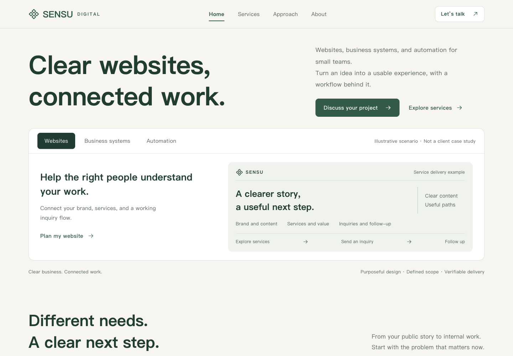
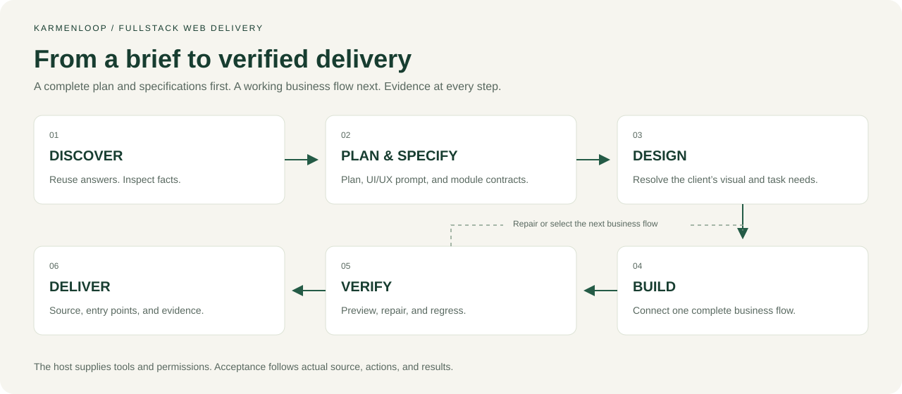
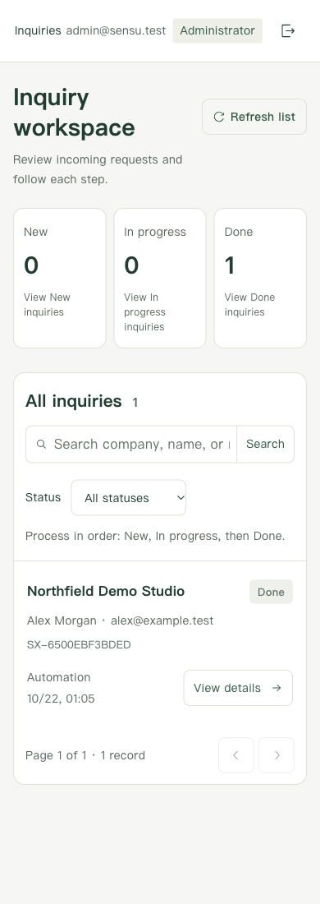
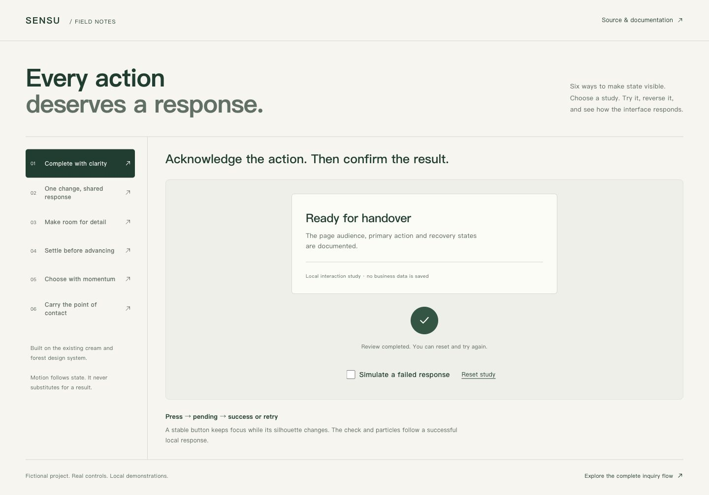
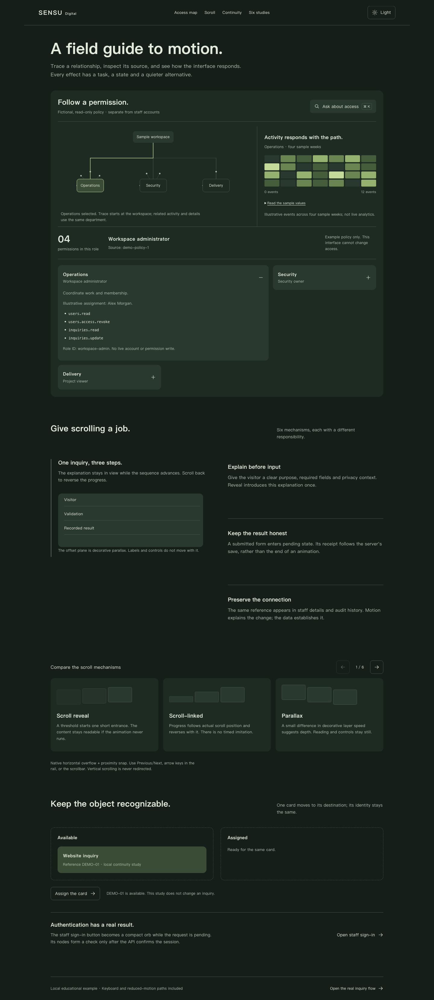
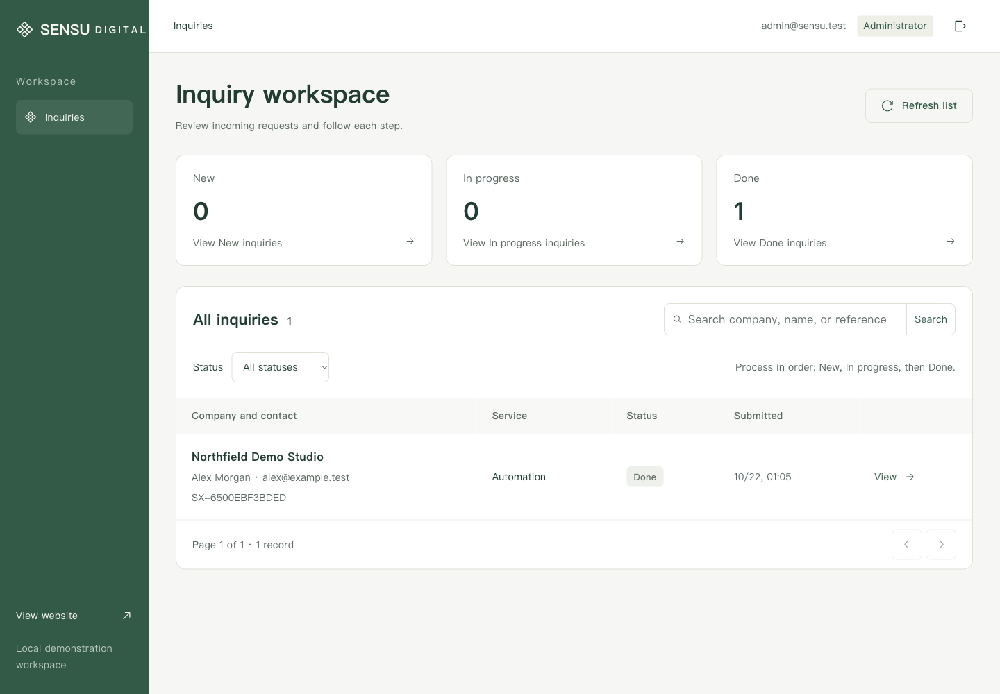

# Fullstack Web Delivery

A workflow skill for turning a website brief into a complete plan, a running implementation, and evidence you can inspect.

**Version 0.7.0 · English publication · Copyright 2026 KarmenLoop**

[](https://github.com/KarmenLoop/fullstack-web-delivery/actions/workflows/verify.yml)

**License:** [Source-available, no modification](LICENSE). You may install and use the unchanged skill, including for commercial project work. Modifying or redistributing modified project materials requires written permission. Independently created project outputs have a separate exception. This is a custom license, not an OSI-approved open-source license.



*An actual browser capture of the included fictional enterprise example. The interface and documentation are in English. This is an illustrative project, not a customer case or a hosted business service.*

[Downloads](https://github.com/KarmenLoop/fullstack-web-delivery/releases) · [Start here](docs/quickstart.md) · [Workflow](docs/workflow.md) · [Design method](docs/design-method.md) · [Full project plan](docs/project-plan.md) · [Generated specifications](docs/generated/sensu/README.md) · [Interaction studies](docs/interaction-studies.md) · [Motion guide](docs/motion-guide.md) · [Example walkthrough](docs/example-guide.md) · [Verification](docs/verification.md) · [License](docs/licensing.md)

## What it delivers

The skill helps an agent build brand websites, administration interfaces, and web applications according to the actual project. It covers discovery, research, architecture, content, UI/UX, frontend, APIs, authentication, persistent data, administration, preview, repair, and handover. It selects the relevant modules; a three-page portfolio does not automatically receive an account system.

It is a set of instructions and references, not a model, framework, hosting service, or background runtime. The host agent supplies file access, terminal, search, browser, permissions, and any external services. Read the [capability and platform limits](docs/platforms.md).

| Stage | Concrete result |
| --- | --- |
| Adaptive discovery | Existing answers reused; four to six consequential questions per round only where decisions are missing |
| Research | Relevant industry references, design principles, and GitHub candidates with adoption/rejection reasons |
| Complete plan | Sitemap, menus, page templates, content, architecture, roles, states, APIs, data, delivery, and acceptance |
| Project specification pack | Filled UI/UX prompt, page audiences/content/actions, linked states, motion and relevant module contracts with traceability |
| Three-layout review | Comparable working A/B/C layouts, browser presentation, matched views and real selection or delegated choice |
| Client-specific design | One coherent selected system checked for both visual quality and task usability |
| Business increments | A complete flow through UI, API boundaries, permissions, storage, and feedback |
| Continuous preview | An actual reachable preview and checks immediately after each increment |
| Repair and acceptance | Reproductions, corrections, affected-scope rechecks, production regression, and agreed persistence checks |
| Handover | Runnable source, commands, entry points, records, known limits, and release conditions |

## Install the skill

Release downloads provide a standalone skill archive and a complete source/documentation/example archive. You can also clone the repository into a location you control:

```sh
git clone https://github.com/KarmenLoop/fullstack-web-delivery.git
cd fullstack-web-delivery
```

Copy `skills/fullstack-web-delivery` into your agent's supported skill directory. Preserve the entire folder, including references and legal notices. Avoid replacing an existing installation without checking it. For a fresh Codex user-level installation:

```sh
mkdir -p ~/.agents/skills
cp -R skills/fullstack-web-delivery ~/.agents/skills/
```

Invoke it with a real brief:

```text
Use $fullstack-web-delivery to build our company website.
Reuse the requirements and brand material already in this project.
We need service pages, an inquiry form, staff sign-in, and an admin workspace.
Deliver the complete plan before implementation, then continue authorized
local development, preview, repair, and acceptance.
For a new design, open three representative layouts for my feedback before
expanding the selected direction. Continue independent authorized work meanwhile.
Use fictional data and keep the preview local.
```

The forty-question discovery pool is not a forty-question obligation. The agent should inspect technical facts itself, reuse supplied answers, and ask only for consequential decisions. See [installation and invocation](docs/quickstart.md) for fresh versus existing installations and a manual file-reading route.

## How the agent chooses the next step



1. Read project rules, source, existing decisions, and authorization.
2. Separate business decisions from facts it can inspect and reversible choices it can make.
3. Research the client's industry and actual user tasks before choosing a visual direction or dependency.
4. Deliver the complete plan and project-specific specification pack before implementation. Continue when development is already authorized; wait only at a review gate the user requested.
5. For new sites or substantial visual redesigns, build three distinct representative layouts and open the comparison for feedback. Reuse a specifically chosen layout or targeted-fix scope. Record the actual selection or explicit delegation before expanding dependent templates; check appearance and the primary task separately.
6. Select the next flow with satisfied dependencies, high business value, or a consequential uncertainty to resolve.
7. Operate it, inspect its data and access boundaries, repair observed defects, and verify affected scope.
8. Regress the agreed site, production build, and persistence before handover.

An unavailable credential blocks its integration branch, not unrelated public content. A failed probe is inspected before blaming the product. An uncertain save is not automatically repeated. A screenshot, build, or author statement is not a complete end-to-end result. The [workflow guide](docs/workflow.md) explains these decisions and recovery rules.

## Design for the client, not the template

The design process starts with the client's field, audience, content, and task. It studies relevant mature businesses, extracts specific principles, and translates them into a project-specific composition. GitHub libraries supply implementation mechanisms, not a reason to mix several branded skins.

For the services example, research included Thoughtworks and Work & Co for service organization, Stripe for explaining mechanisms, Linear for task hierarchy, Apple HIG for layout and purposeful motion, and Primer Brand/Carbon for component responsibilities. Radix Dialog and Motion were already in use and retained; reference code and customer material were not copied.

The resulting interface uses a cream/forest palette, an explicit business proposition, three distinct service demonstrations, consistent detail pages, clear inquiry feedback, and a separate phone record list. Apple principles inform hierarchy, grouping, feedback, and interruptible motion; they do not prescribe a universal glass treatment. Sources and decisions are in [reference research](docs/reference-research.md).



*Phone usability is checked by finding and completing the task, not merely by eliminating page overflow.*

## Compare before expanding the site

Version 0.6.0 adds a visual review stage. A new site or substantial visual redesign starts with three representative layouts that differ in information order, composition, hierarchy or navigation while sharing the real brief, core content and brand constraints. The agent operates the important controls, opens the local comparison in the user-facing browser, and presents matched desktop/phone views with identifiable links and tradeoffs.

Users can select, combine, revise or reject the options. A pending preference blocks its dependent visual expansion while independent authorized work can continue. An explicitly delegated choice is recorded as the agent's decision. A selected layout or narrow repair is preserved. Later consequential design choices also use working previews, annotated views or flow diagrams when useful. Read [the visual review tutorial](docs/visual-decisions.md). This is a workflow update; the existing SENSU captures are not a new three-layout trial.

## From answers to concrete design instructions

After discovery, the agent produces documents that say who each page serves, what it contains, where each control goes, which state confirms an operation, how elements move together, and how failures recover. The [actual generated SENSU pack](docs/generated/sensu/README.md) contains 17 files, including a [copyable UI/UX prompt](docs/generated/sensu/UI-UX-PROMPT.md), page/action/motion contracts, a placement map, seven engineering specifications, decisions, traceability and a SHA-256 manifest.

The optional standard-library renderer consumes a populated JSON brief. It does not invent business facts, interview the user or grant authority. The host agent can write the same contracts directly in the client's language. The bundled renderer is English. Existing output directories are protected; revised designs go into a new directory for comparison.

```sh
python3 skills/fullstack-web-delivery/scripts/generate_project_specs.py \
  --brief docs/specification-inputs/sensu.json --out /tmp/sensu-specs-v1
python3 scripts/test_specifications.py -v
```

See [the specification tutorial](docs/specifications.md) for input structure, module selection and safe revision. Generated traceability starts at NOT_RUN, because generation does not prove implementation.

## Six interaction studies

The example adds `/interaction-lab`, an isolated workbench with one live study at a time: a completion morph/check/particle sequence; linked checklist/ring/count/surface; reversible stacked cards; native snapping cards with a settled timeline; a bounded inertial wheel; and click-origin circular navigation with real URL/history state. These are optional patterns selected by task, not effects to scatter across a client's website.



The studies include explicit state feedback, failure/retry where applicable, keyboard paths and reduced-motion behavior. Completion is labeled as a local simulation; the real inquiry API is separate. [Operate the studies](docs/interaction-studies.md) and inspect their [portable contracts](skills/fullstack-web-delivery/references/interaction-patterns.md).

## Connected motion, with a source and a recovery path

Version 0.7.0 adds a working motion atlas: real-login orb/check feedback, rolling digits, a bounded Command+K permission query, selected department paths, illustrative activity waves, inline disclosure, yielding neighbors, reversible card continuity, light/dark appearance and six distinct scroll mechanisms. These are task-specific capabilities; the skill maps them to pages/actions before implementation rather than applying every effect everywhere.



[Operate the atlas and read the tutorial](docs/motion-guide.md). The permission model is explicitly fictional and read-only, while staff authentication and the inquiry workflow remain real local API/database flows. A supplied video informed the mechanisms; its clip, extracted frames and reference branding are not redistributed. The new [MOTION-MAP](docs/generated/sensu/MOTION-MAP.md) records 16 placements, actual drivers, interruption, alternatives and verification.

## Run the complete example

The included example is **SENSU Digital**, a fictional SME services company. It contains nine public content pages, staff sign-in, and an inquiry workspace. Visitors submit without an account. Read-only staff can inspect; administrators advance New -> In progress -> Done with version checks and an audit history.

Use Node 22.13 or newer within the Node 22 line:

```sh
cd examples/sensu-enterprise
npm ci
npm run setup
npm run build
npm start
```

Open `http://127.0.0.1:4319/`, `http://127.0.0.1:4319/login`, `http://127.0.0.1:4319/interaction-lab`, and `http://127.0.0.1:4319/motion-atlas`. Read `.local/demo-access.json` on your own machine for freshly generated administrator and read-only passwords. No universal demo password is published. The server binds loopback, and no email is sent.

```sh
npm test
npm run verify:http
```

The HTTP check requires the production server. For a different free port, set `PORT` for startup and `SITE_ORIGIN` for verification. The [example guide](docs/example-guide.md) covers the same-record walkthrough, APIs, data, recovery, cleanup, and stopping. The license permits running this example unchanged; adapting its source requires written permission. Independently authored websites created using the skill are addressed separately in [the license guide](docs/licensing.md).



## Verification and honest limits

Versioned bodies of evidence are kept separate:

- The earlier 0.3.0 local rerun recorded 11 formal tests,8 live API checks,18 public viewport checks,12 production routes, and session/data persistence across restarts. Its independent design verdict covered five screenshot/source corrections only.
- The 0.4.1 English publication has fresh source, documentation, test, build, route, and browser checks in [the verification record](docs/verification.md). Historic counts are not silently reassigned to a localized interface. Hosted CI reports its own actual status above.

The 0.7.0 extension records 17 passing application tests, seven specification tests, client/SSR production builds, 14 HTTP routes, same-record/session restart readback and scoped browser checks. Independent review resolved two source-level findings; its ship verdict covers those fixes, not independent whole-product runtime acceptance. See [versioned evidence](docs/verification.md).

The 0.5.0 extension has its own [verification scope](docs/verification.md), including specification tests and interaction observations.

Other agent platforms, physical phones, independent complete runtime QA, a full accessibility/performance audit, transaction flows, external messaging, and public deployment of the website remain unverified unless the evidence explicitly says otherwise. No production-readiness or certification claim is made.

## Repository map

```text
skills/fullstack-web-delivery/  Portable skill and conditional references
examples/sensu-enterprise/     Complete English local example
  src/                        Public pages, form, login, and administration
  server/                     APIs, SQLite, sessions, and page serving
  scripts/                    Setup, cleanup, and HTTP verification
  tests/                      HTTP and isolated maintenance checks
docs/                         Tutorials, workflow, design, planning, and media
evidence/                     Scoped public verification records
scripts/                      Repository checks and release packaging
.github/                      CI and issue forms
LICENSE                       Custom source-available terms
NOTICE                        Copyright, attribution, and affiliation boundaries
THIRD_PARTY_NOTICES.md         Dependency and research distinctions
```

## Reporting an issue and licensing

Use [the issue guidance](CONTRIBUTING.md) for reproducible reports. See [SECURITY.md](SECURITY.md) for sensitive findings and [SUPPORT.md](SUPPORT.md) for scope. Modified forks, translations, patches, rebranding, and derivative distributions require prior written permission. GitHub's own viewing/forking rights and third-party licenses remain intact. Contact `info@karmenloop.com` for additional rights.

Copyright (c)2026 KarmenLoop. Preserve copyright and license notices in permitted copies.
