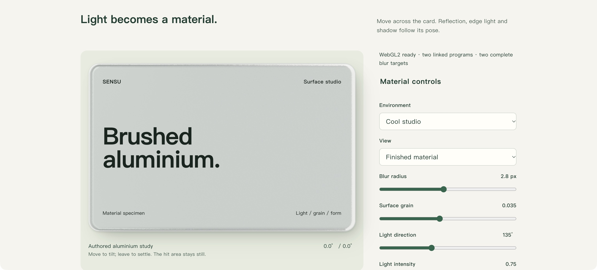
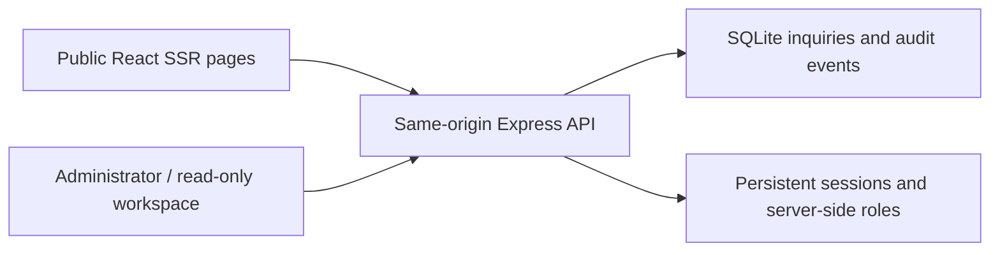

# Fullstack Web Delivery

A reusable agent skill for taking a website from its first brief to a working, reviewable delivery. It brings discovery, project planning, content, UI/UX, frontend, backend, authentication, administration, motion, local preview, and acceptance into one workflow.

**Version 0.9.0 · English documentation · Copyright 2026 KarmenLoop**

[](https://github.com/KarmenLoop/fullstack-web-delivery/actions/workflows/verify.yml)

[Download](https://github.com/KarmenLoop/fullstack-web-delivery/releases/latest) · [Quickstart](docs/quickstart.md) · [Workflow](docs/workflow.md) · [Design method](docs/design-method.md) · [Example walkthrough](docs/example-guide.md) · [Motion and light](docs/metal-material-study.md) · [Verification](docs/verification.md)


*The included SENSU Digital example is a fictional services business with real local inquiry, sign-in, permission, and storage flows. These are browser captures of the running example, not design mockups or customer case studies.*

## What this project includes

The repository contains two useful entry points:

- **A portable skill** for agents building company websites, administration interfaces, and web applications. It reuses known requirements, plans the whole project, and selects the modules the business actually needs.
- **A runnable reference project** with React server rendering, Express APIs, SQLite storage, staff sign-in, an inquiry workspace, six interaction studies, a motion atlas, and a WebGL material and lighting study.

The skill supplies instructions, references, and an optional specification renderer. The host agent supplies its model, tools, permissions, browser, and services. Installing the skill does not start a server or grant access to a client's systems. The SENSU design illustrates the method; it is not a visual template for every client.

## From requirements to delivery


| Step | Work and resulting artifacts |
| --- | --- |
| Understand the project | Identify audience, core tasks, brand, functionality, content, constraints, and existing authorization. Reuse answers; inspect technical facts. |
| Resolve missing decisions | Ask four to six consequential questions per round. The forty-question discovery pool is a resource, not a required questionnaire. |
| Research the field | Study relevant industry leaders, design principles, and GitHub candidates. Record sources, licenses, adoption, rejection, and integration cost. |
| Plan before implementation | Deliver architecture, sitemap, page templates, menu hierarchy, copy logic, roles, business states, APIs, storage, milestones, and acceptance. |
| Define the design | Produce a project-specific UI/UX prompt and page, action, state, content, motion, and engineering specifications. |
| Compare the layout | For new sites and substantial redesigns, open three materially different representative layouts with matched views and working controls. Record the user's choice or explicit delegation. |
| Build the next complete flow | Choose work by dependencies, business value, and uncertainty. Connect the interface, API, permissions, storage, and feedback. |
| Preview and repair | Operate each flow locally, check failure and permission paths, inspect narrow screens, fix observed defects, and recheck affected behavior. |
| Accept and hand over | Regress agreed flows, production builds, and restart persistence. Deliver source, commands, entry points, documents, evidence, and remaining release conditions. |

A plan-only request ends with a plan and implementation handoff. Previously authorized local development continues after the plan unless the user required a review gate. A missing integration credential blocks its dependent branch while independent work can continue. A selected visual direction or targeted repair keeps its existing scope.

Read [the workflow](docs/workflow.md), [complete project plan](docs/project-plan.md), and [visual decision tutorial](docs/visual-decisions.md).

## Project-specific design and specifications

Design starts with the client's field, audience, real content, and primary task. Relevant mature businesses inform hierarchy, service organization, navigation, and interaction. Their principles are translated into the client's own system rather than combining unrelated branded skins.

The method draws on industry references, Apple interface principles, and the Taste and Impeccable design approaches. Those references inform deliberate composition, continuity, feedback, and bounded review; their text is not bundled or relicensed. The skill does not require those third-party skills to be installed. See [reference research](docs/reference-research.md) and [UI matching](docs/ui-matching.md).

The populated [SENSU specification pack](docs/generated/sensu/README.md) contains 18 documents:

| Area | What the documents make explicit |
| --- | --- |
| UI/UX and design | Reader, task, brand, composition, typography, spacing, surfaces, assets, responsive behavior, accessibility, and a copyable implementation prompt |
| Pages and navigation | Who sees each page, its content and hierarchy, primary action, destination, menu placement, and phone behavior |
| Actions and motion | Trigger, state owner, immediate feedback, pending and confirmed results, linked responses, interruption, failure, recovery, and reduced motion |
| Frontend and backend | Rendering, routing, components, API methods and callers, validation, errors, idempotency, and integration boundaries |
| Authentication and data | Session lifecycle, server-side roles, entities, legal transitions, audit, retention, and isolated test data |
| Content and business | Voice, factual claims, company information, brand narrative, sourced trust evidence, media rights, and applicable commercial terms |
| Preview and acceptance | Setup, commands, actual entry points, process ownership, end-to-end scenarios, evidence, defects, and rechecks |
| Decisions and traceability | Reused answers, assumptions, research, authority, requirement mapping, and exact document hashes |

The optional Python renderer writes these contracts from a populated JSON brief. It validates references and protects existing output directories. Generated execution results start at `NOT_RUN`; an intact manifest establishes reproducible documents, not completed implementation.

```sh
python3 skills/fullstack-web-delivery/scripts/generate_project_specs.py   --brief docs/specification-inputs/sensu.json   --out /tmp/sensu-specs-v1
```

Use a new output directory for a revision. See [the specification tutorial](docs/specifications.md), [filled UI/UX prompt](docs/generated/sensu/UI-UX-PROMPT.md), and [UI matching decisions](docs/generated/sensu/UI-MATCH-SPEC.md). The 0.8 specification snapshot records an earlier material deferral; the later [material implementation brief](docs/metal-card-brief.md) records its adoption as a separate atlas study.

## Interaction, motion, and light

Motion is assigned to a task and state before implementation. Buttons respond at input, pending work stays distinct from success, and linked elements share one source of state. Keyboard, touch alternatives, reduced motion, interruption, and recovery belong to the contract.

| Included study | Working mechanisms |
| --- | --- |
| Completion feedback | Button-to-circle morph, drawn check, bounded particles, and a labeled local success/failure simulation |
| Linked response | Checklist, progress ring, rolling count, and surface change driven by the same state |
| Expand and settle | Reversible stacked cards; native snapping cards with a settled timeline; a bounded inertial wheel |
| Navigation continuity | Click-origin circular transition with real URL/history state and reversible card transfer |
| Operational feedback | Actual login orb/check confirmation, a bounded Command+K policy query, department paths, illustrative activity, inline detail, and yielding neighbors |
| Scroll behavior | Separate reveal, scroll-linked progress, parallax, sticky context, proximity snap, and local horizontal overflow |
| UI craft | Tabular numeric ranges, concentric radii, grouped entrances, balanced headings, layered elevation, and light/dark appearance |
| Reflective material | Authored environment texture, horizontal/vertical GPU blur, bevel/grain normals, reflected sampling, and shared pointer springs |
| Light and shadow | Adjustable direction/intensity, face and bevel highlights, a light-only diagnostic view, and a soft pose-dependent CSS shadow projection |


The atlas's permission policy is explicitly fictional and read-only. Staff authentication and the inquiry workflow use real local APIs and persistent data. A successful animation never substitutes for a saved result.



The material study exposes surface, normal, reflection, and light views, actual GPU pixel comparisons, and context loss/restoration. Reflection and highlights run on the GPU; the cast shadow is an identified CSS projection, not a ray-traced shadow. Unsupported contexts retain readable static content. Native Chrome rendered the local trial; the embedded browser exposed its static fallback.

Explore [the six interaction studies](docs/interaction-studies.md), [motion atlas](docs/motion-guide.md), and [material and lighting tutorial](docs/metal-material-study.md). Effects are selected by purpose, not added as a checklist to every site. Original reference videos, private captures, and extracted frames are excluded from distribution.

## Install and use the skill

Choose the **standalone skill archive** for installation, or the **complete archive** for the skill, runnable example, tutorials, images, and scoped evidence. Releases include SHA-256 checksums and integrity records.

To work from source:

```sh
git clone https://github.com/KarmenLoop/fullstack-web-delivery.git
cd fullstack-web-delivery
```

For a fresh Codex user-level installation, copy the entire skill folder and preserve its relative references and legal notices:

```sh
mkdir -p ~/.agents/skills
cp -R skills/fullstack-web-delivery ~/.agents/skills/
```

Inspect an existing installation's version and origin before replacing it. Invoke the skill with a real project brief:

```text
Use $fullstack-web-delivery to build our company website.
Reuse the requirements and brand material already supplied.
We need service pages, an inquiry form, staff sign-in, and an admin workspace.
Deliver the complete plan and filled specifications first, then continue
local development, preview, repair, and acceptance.
For a new design, open three representative layouts for my feedback before
expanding the selected direction. Keep the trial local with fictional data.
```

Setup documentation covers Codex, Claude Code, Cursor, Qoder, WorkBuddy, Koder, and Koder CLI. Native discovery, tool capabilities, and runtime acceptance differ by host; only the Codex desktop field trial is recorded as executed. A file-capable agent can read the actual `SKILL.md` and relevant references manually. Cloud sessions require their own accessible files and supported preview forwarding.

Read [the quickstart](docs/quickstart.md) and [platform evidence matrix](docs/platforms.md) before choosing an installation route.

## Run the complete SENSU example

SENSU Digital is a fictional SME services company. The example contains nine public content pages, visitor consultation, staff sign-in, an inquiry workspace, and the interaction/atlas routes. Visitors submit without an account. Read-only staff inspect records; administrators advance `New → In progress → Done` with version checks and transactional audit history.



Use Node 22.13 or newer within the Node 22 release line. From the repository root:

```sh
cd examples/sensu-enterprise
npm ci
npm run setup
npm run build
npm start
```

| Local entry | Purpose |
| --- | --- |
| `http://127.0.0.1:4319/` | Public company website |
| `http://127.0.0.1:4319/contact` | Visitor inquiry and saved reference |
| `http://127.0.0.1:4319/login` | Staff sign-in and role-based workspace |
| `http://127.0.0.1:4319/interaction-lab` | Six interaction studies |
| `http://127.0.0.1:4319/motion-atlas` | Connected motion and scroll mechanisms |
| `http://127.0.0.1:4319/motion-atlas#material` | WebGL material, light, and shadow study |

Setup generates random administrator and read-only credentials in `.local/demo-access.json` on the operator's machine. No universal password is published. The server binds loopback; no email, payment, external CRM, or real customer contact is included. Private data, credentials, dependencies, and generated build output are excluded from the release archives.

```sh
npm test
npm run verify:http
```

The HTTP check requires the production server. For a different free port, set `PORT` at startup and `SITE_ORIGIN` for verification. Follow [the example walkthrough](docs/example-guide.md) for receipt-to-admin matching, API boundaries, data, restart, stopping, and explicit cleanup.


## Verification and limits

The [versioned verification record](docs/verification.md) separates source review, automated checks, actual browser operation, screenshots, independent review, and device acceptance. The recorded 0.9.0 results include:

| Check | Recorded result | Scope |
| --- | --- | --- |
| Application tests | 19 passed | Business/API/maintenance checks and spring/hit-area math |
| Specification tests | 9 passed | Reference validation, output protection, and reproducibility |
| Production build and routes | Client/SSR builds; 14 routes passed | Rendering, metadata, status, landmarks, and CSP |
| GPU execution | Native Chrome WebGL2 checks passed | Real blur-stage pixels and changed output under tilt, bevel, grain, and light fixtures |
| Browser operation | Pointer, keyboard light changes, diagnostic modes, context loss/restoration | Author observations, separate from controlled GPU fixtures |
| Independent finish review | Source and desktop/phone/fallback captures passed | Composition and sampled source; no independent temporal or physical-device certification |
| Restart readback | Original completed record and two audit events retained | Read-only check after the owned production restart |
| Hosted CI | Linked workflow runs against the published commit | Automated repository and example jobs |

Earlier versions retain their own evidence rather than inheriting current results. Real-phone gestures, GPU timing/FPS, full accessibility/security audits, other agent-host runtimes, and public deployment of the example remain unverified where not explicitly recorded. Source guards and still images do not establish those outcomes.

## Documentation and repository map

| Directory | Contents |
| --- | --- |
| `skills/fullstack-web-delivery/` | Portable instructions, conditional references, optional renderer, and legal notices |
| `examples/sensu-enterprise/` | Public pages, inquiry, sign-in, administration, APIs, storage, studies, and tests |
| `docs/` | Planning, design, installation, operating tutorials, generated contracts, and actual images |
| `evidence/` | Versioned check results, source fingerprints, capture provenance, and bounded reviews |
| `scripts/` | Repository validation, specification tests, and release packaging |
| `.github/` | Hosted verification and issue forms |

Start with [installation](docs/quickstart.md), [project planning](docs/project-plan.md), [specifications](docs/specifications.md), or [verification](docs/verification.md). [The changelog](CHANGELOG.md) preserves the release history.

## License and support

This project uses the [KarmenLoop Source-Available No-Modification License](LICENSE), not an OSI-approved open-source license. You may install and use the unchanged skill, including for commercial project work, and run the unchanged example locally. Modified instructions, example source, translations, rebranding, patches, or derivative distributions require prior written permission. Permitted copies must retain copyright and legal notices.

Independently created website or application outputs have a separate exception; copying or adapting the included example source does not qualify automatically. Third-party licenses and GitHub platform rights remain intact. Read [the license guide](docs/licensing.md), [NOTICE](NOTICE), and [third-party notices](THIRD_PARTY_NOTICES.md).

For reproducible issues, follow [CONTRIBUTING.md](CONTRIBUTING.md). Use [SECURITY.md](SECURITY.md) for sensitive findings and [SUPPORT.md](SUPPORT.md) for scope. Contact `info@karmenloop.com` for additional rights.

Copyright (c) 2026 KarmenLoop. All rights reserved except as granted in LICENSE.
