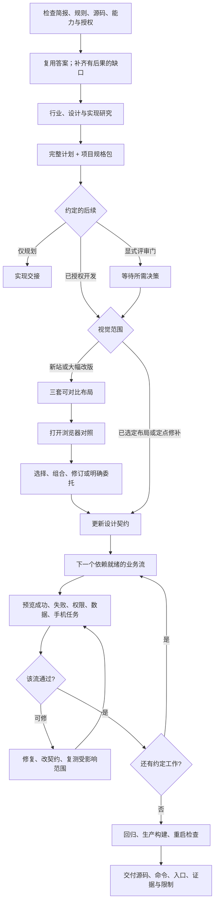
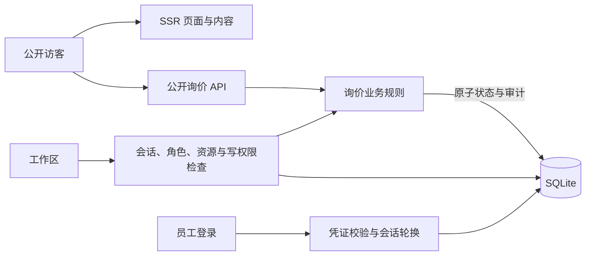

# Fullstack Web Delivery · 网站完整交付

[English](README.md) · [中文](README.zh-CN.md) · **v0.9.1**

[](https://github.com/KarmenLoop/fullstack-web-delivery/actions/workflows/verify.yml)
[](https://github.com/KarmenLoop/fullstack-web-delivery/releases/latest)
[](https://nodejs.org/)
[](LICENSE)
[](skills/fullstack-web-delivery/SKILL.md)

**把网站需求变成完整计划、项目规格、可运行业务增量，以及可检查的本地交接——不编造产品事实，也不跳过验收。**

Fullstack Web Delivery 是一套可移植的 **Agent Skill**，用于规划并交付完整网站；并附带可在本机回环地址运行的 **虚构企业示例 SENSU**（React / Express / SQLite）。Skill 提供的是工作流纪律：自适应发现、行业研究、按客户定制的 UI/UX、认证与持久化、预览，以及基于证据的验收。它**不会**替你授予宿主工具权限、云凭证、邮件发送、支付能力或生产部署。

由 [KarmenLoop](https://github.com/KarmenLoop) / [KARMENLOOP](https://karmenloop.com) 维护。当前版本：**[v0.9.1](https://github.com/KarmenLoop/fullstack-web-delivery/releases/tag/v0.9.1)**。许可：**KarmenLoop Source-Available No-Modification License 1.0**。


*v0.9.1 本地 SENSU 截图；虚构企业与合成数据。旧研究保留其原始版本记录。*


[下载 v0.9.1](https://github.com/KarmenLoop/fullstack-web-delivery/releases/tag/v0.9.1) · [中文教程](docs/tutorial.zh-CN.md) · [English guide](docs/tutorial.en.md) · [示例走查](docs/example-guide.md) · [验收边界](docs/verification.md)

---

## 为什么做这个

常见的「帮我搭个站」提示，很容易塌成好看的页面，却分不清 **规划、视觉选择、业务流、验收** 的边界。Agent 会编造未回答的事实、只做前端不做授权与存储、把截图当证明，或把所有交互花样硬塞进每个项目。

本仓库把网站交付当成**系统工作流**：

- 复用已回答需求，技术事实自己核查；
- 只问缺失且有后果的决策；
- **先交完整计划与项目规格包，再实现**；
- 新站或大幅视觉改版时，先打开 **三套可对比布局** 再扩模板；
- 按依赖就绪的 **业务增量** 推进（UI + API + 规则 + 认证 + 存储 + 反馈一起做）；
- 对正常、失败、权限、数据、手机任务与交互场景分别取证。

它不替代宿主的模型、工具或权限，也不声称「文档里写过的每个安装路径都已跑通」。交付的是稳定的方法层，外加一套能端到端操作的本地示例。

---

## 一览

| | |
|---|---|
| **安装内容** | `skills/fullstack-web-delivery/` 可移植 Skill（`SKILL.md`、`references/`、教程、可选 Codex 元数据、可选 Python 规格渲染器） |
| **可运行示例** | `examples/sensu-enterprise` — React SSR、Express、本地 SQLite |
| **版本** | **0.9.1**（`VERSION`、示例 `package.json`、发布标签） |
| **示例运行时** | Node **22.13+**（Node 22 线）与 npm |
| **本地预览** | `http://127.0.0.1:4319`（仅回环；需要时可设 `PORT` / `SITE_ORIGIN`） |
| **演示账号** | `npm run setup` 后写入 `.local/demo-access.json` 的随机凭证 — 务必本地私有 |
| **规格交接** | 项目 UI/UX 提示词、页面/动作/动效契约、模块规格与追溯（见 `docs/specifications.md`，填充示例在 `docs/generated/sensu/`） |
| **示例研究页** | `/interaction-lab`、`/motion-atlas`、`/motion-atlas#material`（WebGL2 标本；无 WebGL2 时有静态回退） |
| **CI** | GitHub Actions **Verify**：仓库/发布校验 + 示例测试/构建/HTTP 路由 |
| **许可** | 源码可见、**禁止修改 / 禁止衍生分发** Materials（除非书面授权）；用未改 Skill 独立做出的项目成果另有例外（见 [LICENSE](LICENSE)） |

---

## 是什么 / 不是什么

| 是 | 不是 |
|---|---|
| 网站交付 **Skill** + 可运行的虚构企业示例 | 托管建站 SaaS 或模板商城 |
| 计划 → 规格包 → 增量 → 证据交接 | 「一句话生成整站」且无验收 |
| SENSU 里真实的本地认证、角色、SQLite 与审计 | 邮件、支付、外部 CRM 或生产部署 |
| 新站/大改时的三布局视觉对比 | 选了色板就等于选了布局 |
| 六种交互研究与 motion atlas，**按任务选用** | 每个客户站都必须装齐六种效果 |
| verification 里诚实的 NOT_RUN / 设备 / 性能边界 | 宣称 CI 等同真机或完整无障碍/安全审计 |
| 可用未修改 Skill 做个人或商业项目 | 默认可改 Materials 或公开发布改包 |

---

## 架构

三块刻意分开：

1. **方法层（Skill）** — `SKILL.md` 路由发现、研究、规划、视觉决策、实现与交付；条件加载 `references/`。Skill 增加的是指令，不是执行权限。
2. **规格便利层** — 发现完成后，同一轮规划交接应带上填好的项目规格包。可选、无第三方运行时依赖的 Python 渲染器（`skills/fullstack-web-delivery/scripts/generate_project_specs.py`）可生成同样文档；宿主也可直接写。
3. **可运行示例（SENSU）** — 同一 Express 进程提供 SSR 页面与同源 API，落本地 SQLite。公开内容渲染、匿名询价写入、会话认证、角色校验后的工作区变更是不同边界——不是微服务拆分。

### 交付流程



### 请求架构（SENSU）



保存询价只代表**本地持久化**，不代表「邮件已发出」。违反角色或 CSRF 的直连 API 写入由服务端拒绝；浏览器里藏掉控件不等于授权。

---

## Skill 实际驱动什么

### 自适应发现与研究

- 从「谁要完成什么、成功长什么样」开始。
- 每轮只问约四到六个有后果的缺口（候选池不是固定四十题配额）。
- 运行时、路由、API、工具自己查；业务事实与材质偏好再问人。
- 先研究客户行业与成熟参照，再谈皮肤；记录采纳、拒绝、许可与成本。

### 完整计划 + 规格包

实现前交付站点计划（分层、站点图、模板、表单到后台流、API、角色、数据、里程碑、验收），以及**针对本项目**的规格包：UI/UX 实现提示词、页面受众/内容/动作、状态与动效契约、模块规格、需求到验收追溯。空模板不算交接。见 [docs/specifications.md](docs/specifications.md) 与填充示例 [docs/generated/sensu/](docs/generated/sensu/README.md)。

### 视觉决策

新站或大幅视觉改版：同一套真实内容下三套实质不同的布局，打开对照并给出桌面/手机匹配视图与取舍。选了色板不等于选了布局。保留已明确选定的布局与定点修补范围。详见 [docs/visual-decisions.md](docs/visual-decisions.md)。

### 业务增量（询价示例）

| 增量 | 退出证据 |
|---|---|
| 基线与设计 | 页面可达；视觉与任务检查 |
| 访客询价 | 回执与 SQLite 保存记录一致 |
| 员工访问 | 同一编号可见；只读角色直写被拒 |
| 管理员处理 | 合法状态迁移 + 匹配审计历史 |
| 响应式交互 | 实际操作行为与视口证据 |
| 最终验收 | 生产页、核心流、约定的重启持久 |

### 交互、动效与材质（按需选用）

- **交互实验室** — `/interaction-lab` 六种可操作研究；按任务选，不要每个站装齐（[docs/interaction-studies.md](docs/interaction-studies.md)）。
- **Motion atlas** — 滚动驱动、命令搜索、部门状态协同、减少动效路径（[docs/motion-guide.md](docs/motion-guide.md)）。
- **反光材质** — `/motion-atlas#material` 的 WebGL2 标本；无 WebGL2 时有可读回退（[docs/metal-material-study.md](docs/metal-material-study.md)）。

---

## 快速开始

### A. 跑 SENSU 示例（不必先装 Skill）

**要求：** Node 22.13+（Node 22 线）、npm，以及空闲回环端口（默认 **4319**）。

```sh
cd examples/sensu-enterprise
npm ci
npm run setup
npm run build
npm start
```

打开 `http://127.0.0.1:4319/`。员工入口：`/login`。工作区：`/admin`。

setup 会把随机本地访问资料写到 `.local/demo-access.json`。**不要提交、粘贴或截进图里。**

**第一次有用的任务**

1. 在公开站提交一条虚构询价，保存返回编号。
2. 用生成的**只读**账号登录，找到该编号，确认无法改状态。
3. 退出后用**管理员**账号：New → In progress → Done，并查看历史。
4. 刷新（或重启你自己启动的进程），确认同一记录与会话预期仍在。

测试：`npm test`。生产模式运行中：`npm run verify:http`。停止：Ctrl+C。清理可丢弃的本地询价：`npm run data:clear -- --confirm-local`（保留账号）。完整走查：[docs/example-guide.md](docs/example-guide.md)。

### B. 安装可移植 Skill

需要示例与双语指南时选 **complete** 发布包；只要工作流选较小的 **skill** 包。将其中的 `fullstack-web-delivery` 文件夹放入**一个**宿主支持的技能目录，使用**新目录**。刷新发现或新开会话，打开已安装的 `SKILL.md`，确认版本为 **0.9.1**。

若使用 Codex 风格的 agents 目录：可新建 `~/.agents/skills`（或项目内 `.agents/skills`），把完整 Skill 文件夹拷进去。其他本地 Agent 宿主有各自的技能根目录——见 [docs/platforms.md](docs/platforms.md)，依赖原生发现前请先核对该目标版本。具备读文件能力的 Agent 也可直接指向 `SKILL.md` 的绝对路径；那只证明你实际走通的读取路径。

**建议的首条提示**

```text
使用 $fullstack-web-delivery。
项目：[业务、受众、主任务]。
已有材料：[路径或已提供上下文]。
所需能力：[公开页、账号、表单、后台、集成]。
视觉与文案约束：[已知决策或参照]。
授权：先交付完整计划，再继续本地开发。
评审门：[仅我明确要求的门]。
验收：[关键端到端任务与设备]。
```

若只要计划，就不应开始实现。若已授权本地开发且无额外评审门，计划交付后应进入开发——视觉范围需要时，从三布局对比开始。

长文：[docs/tutorial.zh-CN.md](docs/tutorial.zh-CN.md) · [docs/quickstart.md](docs/quickstart.md)。

---

## 文档地图

| 文档 | 需要时看… |
|---|---|
| [中文教程](docs/tutorial.zh-CN.md) · [English](docs/tutorial.en.md) | 下载、安装、首任务、更新/卸载 |
| [Quickstart](docs/quickstart.md) | Skill 提示形态 + SENSU 命令 |
| [Workflow](docs/workflow.md) | 决策路由与增量顺序 |
| [Platforms](docs/platforms.md) | 已文档化的技能目录与证据矩阵 |
| [Specifications](docs/specifications.md) | 规格包形态与渲染器 |
| [Generated SENSU pack](docs/generated/sensu/README.md) | 已填充契约示例 |
| [Example guide](docs/example-guide.md) | 端到端询价 / 角色 / API |
| [Visual decisions](docs/visual-decisions.md) | 三布局对比 |
| [Interaction studies](docs/interaction-studies.md) | 六模式实验室 |
| [Motion guide](docs/motion-guide.md) · [Metal study](docs/metal-material-study.md) | Atlas 与反光材质 |
| [Verification](docs/verification.md) | 跑了什么、哪些仍是 NOT_RUN |
| [Licensing](docs/licensing.md) · [LICENSE](LICENSE) | 源码可见条款白话说明 |
| [CHANGELOG](CHANGELOG.md) | 到 0.9.1 的版本史 |
| [PRODUCT.md](PRODUCT.md) | 产品目的与品牌约束 |
| [SECURITY](SECURITY.md) / [SUPPORT](SUPPORT.md) / [CONTRIBUTING](CONTRIBUTING.md) | 运维与贡献 |

---

## 验收说明（诚实）

**托管 CI（`Verify` 工作流）** 在 push/PR 上跑：Python 规格测试、`check_repository.py`、`check_publication.py`（双语文档须含版本子串 **0.9.1**、相对链接须存在、绑定媒体/源码摘要须匹配），以及 SENSU 套件（`npm test`、setup、build、生产 HTTP 路由校验），环境为 Ubuntu + Node 22。

**维护者证据**（见 [docs/verification.md](docs/verification.md) 与 `evidence/`）另有浏览器操作、截图、重启回读，以及至 **0.9.x** 的版本化研究。以各证据文件声明的范围为准——不要把旧截图抬成新版本结论。

**不声称**

- SENSU 或任何客户站已公网部署；
- 邮件、支付或外部 CRM 集成；
- 用静帧证明真机或测得 FPS；
- 完整无障碍、安全或性能审计；
- 文档中每个第三方宿主安装路径都有运行时证明；
- 默认许可下可修改或分发改过的 Materials。

包与 CI 校验的是结构、示例自动化与发布身份，不是每个宿主的模型对话，也不是生产就绪证书。

---

## 常见问题

### 一句话：这是什么？

一套源码可见的 **网站交付 Agent Skill**：把需求变成计划、项目规格与可验证的本地增量；并附带可在回环地址端到端运行的 **React / Express / SQLite** 虚构企业示例。

### 适合谁？

已经在用本地编程 Agent 交付客户网站、希望发现→规格→视觉选择→认证/数据增量→诚实验收可重复的人——而不是再要一份泛化 UI 模板倾倒。

### SENSU 是上线客户站吗？

不是。SENSU 是**虚构**的本地演示。部署、真实账号、邮件、支付与外部服务需要单独配置、授权与检查。

### 安装 Skill 会启动服务或建账号吗？

不会。装 Skill 不会起进程、建账号、授予工具权限或导入云凭证。跑 SENSU 是 `examples/sensu-enterprise` 下单独的 Node 流程。

### 和「让 Agent 直接搭站」有何不同？

Skill 要求 **实现前先交完整计划与规格包**、按依赖排序的 **业务增量**、改版时的显式视觉对比，以及把浏览器操作、API 检查、截图、源码审查与独立审查分开的验收证据；并禁止编造未回答的产品事实。

### 必须用满六种交互和金属卡片吗？

不必。研究页是为了**按任务选用**。Skill 明确要求不要给每个站塞满效果。Metal/WebGL2 是可选标本，无 WebGL2 时有可读回退。

### 示例需要哪个 Node 版本？

Node **22.13+**，且落在 Node **22** 线（见 `examples/sensu-enterprise/package.json` 的 `engines`）。本地发布检查用过 Node 22.x；托管 CI 使用 Node 22。

### 可以改 Skill/示例再公开发布吗？

默认 [LICENSE](LICENSE) 允许查看、下载、精确复制、安装，以及使用**未修改** Materials（含用未改 Skill 做商业项目）。**修改、改编或分发衍生 Materials** 需 KarmenLoop 事先书面许可。用未改 Skill **独立做出**的网站属另一例外，本许可不主张其权利。复制或改编附带示例源码**不属于**该例外。

### 文档冲突时信谁？

信 `VERSION` / 发布标签 **v0.9.1**、[CHANGELOG.md](CHANGELOG.md)、[docs/verification.md](docs/verification.md) 与教程。历史 `evidence/v0.x-*` 仍归属产生它的版本。

### 可发现性（克制）

与本仓库实际相符的检索说法包括：**网站交付 Skill**、**全栈网站 Agent 工作流**、**React Express SQLite 本地演示**、**面向 Agent 的项目规格包**、**询价表单 + 员工后台与审计**、**按任务选用的 interaction lab / motion atlas**。不做关键词堆砌；实质在 Skill 与示例里。

---

## 许可与联系

[KarmenLoop Source-Available No-Modification License 1.0](LICENSE) — 另见 [NOTICE](NOTICE)、[THIRD_PARTY_NOTICES.md](THIRD_PARTY_NOTICES.md)、[docs/licensing.md](docs/licensing.md)。这不是 OSI 认可的开源许可，因为它限制 Materials 的修改与衍生分发。

维护者：[KarmenLoop](https://github.com/KarmenLoop) · 站点：[karmenloop.com](https://karmenloop.com) · 额外授权申请：info@karmenloop.com

问题反馈：[GitHub Issues](https://github.com/KarmenLoop/fullstack-web-delivery/issues) · 支持策略：[SUPPORT.md](SUPPORT.md)。报示例问题时请优先使用合成数据。
