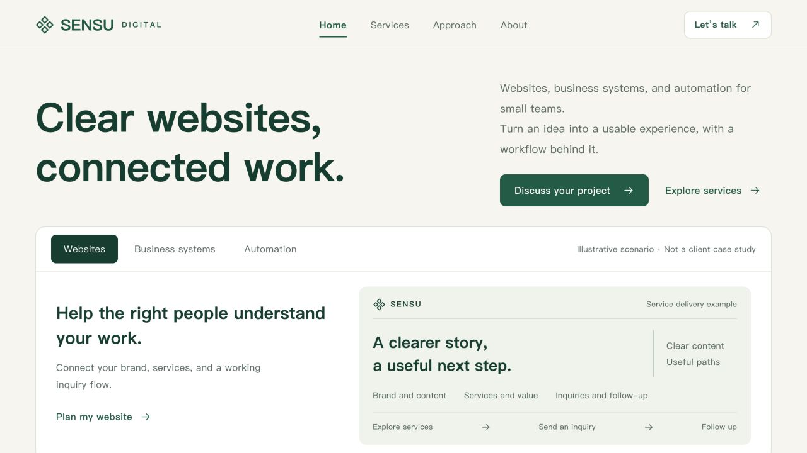

# Fullstack Web Delivery · 网站完整交付

[English](README.md) | 简体中文

从网站需求走到能运行的页面和经过检查的本地交付。附带的 SENSU 示例有询价表单、员工访问与保存的记录，让流程可以落实到真实操作。

[下载 v0.9.1](https://github.com/KarmenLoop/fullstack-web-delivery/releases/tag/v0.9.1) · [教程](docs/tutorial.zh-CN.md) · [反馈问题](https://github.com/KarmenLoop/fullstack-web-delivery/issues)

## 用途与范围

这是网站交付技能及一个基于 React、Express、SQLite 的虚构企业示例。示例可在本地运行，不包含邮件发送、支付或外部 CRM 连接。

*v0.9.1 的真实本地 SENSU 截图，使用虚构企业与合成数据；旧研究保留其原始版本记录。*

## 开始使用

需要示例与双语指南时选 complete ZIP；较小的 skill ZIP 只包含可移植工作流程。将其中 fullstack-web-delivery 文件夹放入一个宿主支持的技能目录，使用新目录。

SENSU 示例使用 Node 22.13 及以上的 Node 22 和 npm。在 examples/sensu-enterprise 依次运行 npm ci、npm run setup、npm run build、npm start，打开 http://127.0.0.1:4319。setup 生成随机本地访问资料，位于 .local/demo-access.json，请保留为本地私有文件。

## 第一次有用的任务

提交一条虚构询价，在只读员工视图找到返回的编号，再用管理员角色推进状态，刷新后确认历史仍在。

用网站技能完成一次有边界的页面变更，检查真实表单及错误分支后再判定完成。材质研究与历史截图保留原版本记录，不代表新增的设备或性能验收。

## 常见问题

**SENSU 是已上线客户网站吗？** 不是。它是虚构的本地示例。部署、账号、邮件与外部服务需要单独配置和检查。

## 文档与许可证

[下载到实践的使用指南](docs/tutorial.zh-CN.md) · [LICENSE](LICENSE)

KarmenLoop Source-Available No-Modification License 1.0. 许可证条件以原文为准，再分发时保留包内法律文件。 [KarmenLoop](https://karmenloop.com).
