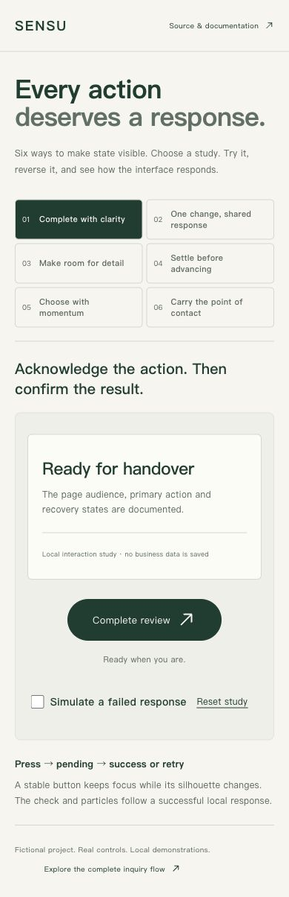

# Operate the interaction studies

Historical study/capture record: **0.5.0**. The current release is **0.9.1**; its new browser capture is on the [project page](../README.md). The captures below retain their original scope and are not fresh acceptance of every feature.

Start the [complete example](example-guide.md), then open `http://127.0.0.1:4319/interaction-lab`. If startup uses a different PORT, use that port here too. The study index changes `?pattern=`; the sixth study adds `&view=`. These links can be opened directly and navigated with browser history.

The workbench extends the existing cream/forest brand and uses existing Motion, Radix icons and native browser controls. It adds no dependency. Only one study is active at a time. Completion and preferences are explicitly local demonstrations; they do not write a consultation, send a message or change staff permissions.

| Study | Try this | Observe |
| --- | --- | --- |
| Complete with clarity | Complete; reset; enable failed response; retry | Immediate pending state, confirmed circle/check/particles or preserved review and error; no duplicate pending action |
| One change, shared response | Check several items; uncheck quickly | Ring, count, text and light supporting surface derive from one completed count and reverse together |
| Make room for detail | Explore, gather, then reverse halfway | Stable cards follow ordered springs; the newest input retargets the current position |
| Settle before advancing | Scroll the cards; use Next, arrows, Home/End | Native snap places the selected card at center; timeline advances after resting selection |
| Choose with momentum | Flick the wheel; pull beyond each bound; use keys/select | Velocity projects a bounded tick, elastic overshoot settles back, selection commits at rest |
| Carry the point of contact | Choose views, toggle reminders, use Back/Forward | Actual destination content and URL agree; reveal starts at the trigger; outgoing content is inert |

All six include keyboard paths and a `prefers-reduced-motion` alternative. The wheel has a native select as well as a spinbutton. Scroll regions remain contained. Resting selection and final results are textual; decorative motion is not an accessibility announcement stream.

## Implementation boundaries

The completion response is a labeled 650ms simulation, including an optional injected failure. A production implementation must wait for its real operation. Button silhouette changes use layout animation, the check is normalized SVG geometry, and the ten particles are decorative and bounded.

The wheel uses a Motion value rather than a React render per frame. A new drag stops existing settling; release projects velocity to a clamped 44px tick and settles with a spring. The committed selected time drives the spinbutton text and select. Physical touch-device feel and frame-rate certification require separate testing.

The snapping timeline prefers scrollend and uses a quiet fallback only where unavailable, guarded by released input and center alignment. Its center calculation stays in the same viewport coordinate space. The radial reveal measures the actual trigger position and farthest corner; its final clipping is removed without interpolating to `none`, so later resizing remains safe. Rapid route changes retain the newest destination; browser history restores content without requiring the originating pointer.

Read [portable pattern contracts](../skills/fullstack-web-delivery/references/interaction-patterns.md) and the [generated motion specification](generated/sensu/MOTION-SPECS.md). Reference values are choices for this example, not universal presets. Primary technical sources: [Motion drag](https://motion.dev/docs/react-drag), [Motion accessibility](https://motion.dev/docs/react-accessibility), and [CSS Scroll Snap](https://www.w3.org/TR/css-scroll-snap-1/).

## What the evidence can establish

Screenshots show composition, content and a captured state. The [versioned verification record](verification.md) separates actual pointer/keyboard/history observations, reduced-motion checks, automated tests, static review and untested devices. A still image cannot prove spring quality, animation frame rate, interruption or server behavior.

The method draws on the locally available Taste and Impeccable skills as references: deliberate task-led composition, coherent state feedback and bounded visual review. No third-party skill text is bundled or relicensed. The public package does not require those skills to be installed. Use the client's industry leaders first, and translate their principles rather than copying a brand skin.
