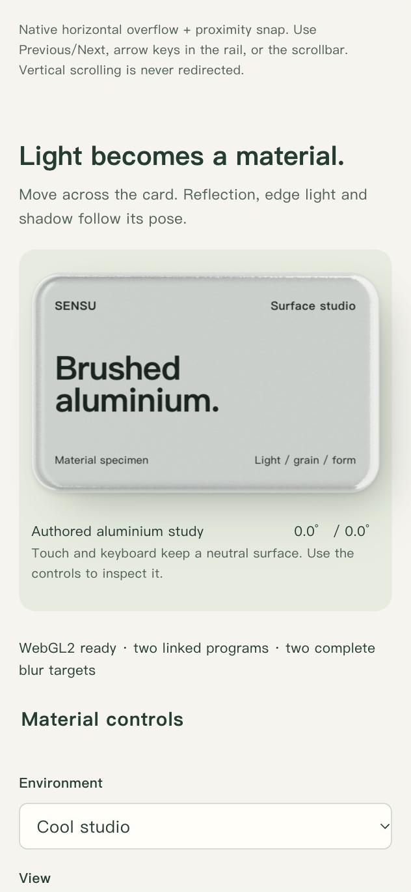

# Operate the reflective material study

Historical study/capture record: **0.9.0**. The current release is **0.9.1**; its new browser capture is on the [project page](../README.md). The captures below retain their original scope and are not fresh acceptance of every feature.

Version 0.9.0 extends the existing SENSU motion atlas. It implements the previously deferred material specimen without changing the enterprise inquiry, authentication or permission model. The original 0.8 specification remains a historical design snapshot; this [implementation brief](metal-card-brief.md) records the later request and scope.

## Open and operate

Follow the [example setup](../examples/sensu-enterprise/README.md), then open `http://127.0.0.1:4319/motion-atlas#material` in a browser that exposes WebGL2. In this local environment native Chrome renders the study; the embedded browser exposes the unsupported-context fallback.

1. Move across the large card. Card pose, reflection, edge light and projected shadow share the same spring angles. Leaving the stable hit area settles to neutral. Reentering changes the target without resetting velocity.
2. Compare Cool studio and Warm gallery. These are owned procedural panoramas, not a screen capture or camera feed.
3. Change blur radius and surface grain. Inspect Finished material, Bevel normals, Reflection only and Light only. Diagnostic views hide the decorative lettering so the shader remains visible.
4. Change light direction and intensity. Face shading and bevel highlights run in the material shader. The soft cast shadow uses layered CSS, driven by that light and the same pose. It is a documented projection approximation, not a ray-traced shadow.
5. Run Check GPU pixels. Save GPU report downloads the actual readback values. The check uses controlled temporary material fixtures, restores the chosen settings and does not submit data to a server.
6. Test context loss. The canvas yields to readable static content and disables unavailable controls. Restore WebGL rebuilds programs, textures and framebuffers. A browser without the extension cannot run this injected-loss scenario.

Native selects, sliders and the motion checkbox support keyboard operation. Coarse pointers preserve native scrolling and a neutral pose; reduced motion immediately stops decorative tilt. Material controls still work. The canvas carries no essential text or action.

The public images are cropped browser pixels; [capture provenance](../evidence/metal-image-provenance.json) records viewport, source size and crop. They are not reference mockups.

## How the renderer works

| Stage | Source | Output and responsibility |
| --- | --- | --- |
| Authored panorama | Local Canvas2D rectangles and soft light boxes, 512x256 | Uploads an actual environment texture; no external image or network dependency |
| Horizontal blur | Source texture, sRGB decoded to linear | Normalized 17-tap Gaussian into the first RGBA8 framebuffer |
| Vertical blur | First target, still linear | Second framebuffer, followed by 72% luminance desaturation |
| Material | Prepared environment and rounded-card distance field | Normalized bevel/grain normal, reflected view direction, directional face/highlight response, one final transfer encoding |
| Pose and shadow | Stable pointer target and retained spring velocity | Shared CSS/shader rotation; layered contact/cast shadow responds to light direction and tilt |

The two blur targets never sample their own attachment. The fixed 512x256 processing budget uses matching texel sizes; the responsive display buffer caps DPR at 1.5. The 28px silhouette and 14px bevel are measured in CSS pixels. Reflection uses a shared 1000px camera/perspective convention. This custom LDR model is art directed; it does not claim a full physically based lighting solution.

The spring uses mass 1, stiffness 180 and damping 24, with bounded time and integration substeps. It stops when settled, offscreen or hidden. Resize and input changes request new work. Teardown removes owned observers/listeners/callbacks and deletes GPU resources. Restoration initializes new resources instead of reusing invalid objects.

Read [MetalCard.jsx](../examples/sensu-enterprise/src/MetalCard.jsx), [renderer.js](../examples/sensu-enterprise/src/metal/renderer.js), the [material shader](../examples/sensu-enterprise/src/metal/material.frag.glsl), [blur shader](../examples/sensu-enterprise/src/metal/blur.frag.glsl), [spring math](../examples/sensu-enterprise/src/metal/math.mjs) and [portable material contract](../skills/fullstack-web-delivery/references/metallic-surfaces.md).

## Match the effect to a client

Use this treatment for an intentional material specimen, product surface or identity object. Specify audience/task, placement, environment ownership, silhouette/insets, bevel, grain, light direction/intensity, shadow mechanism, input range, spring, interruption, accessibility and budget in the UI/UX prompt. Dense forms and staff record lists retain ordinary surfaces. Never apply every atlas effect to a client by default.

## Acceptance boundary

Actual readbacks establish compiled programs, complete targets and changes to real output under controlled fixtures. Actual pointer operation is checked separately from fixture tilt. Context loss, restoration, keyboard changes and viewport measurements are separate observations. Source guards and numerical tests support lifecycle reasoning; they do not independently prove every browser lifecycle or physical device.

See [current verification](verification.md) for executed scope and limits. Physical phone gestures, GPU timing, sustained frame rate, full accessibility/security review and other host runtimes remain unverified. No source video pixels, private accounts or database contents are included.
