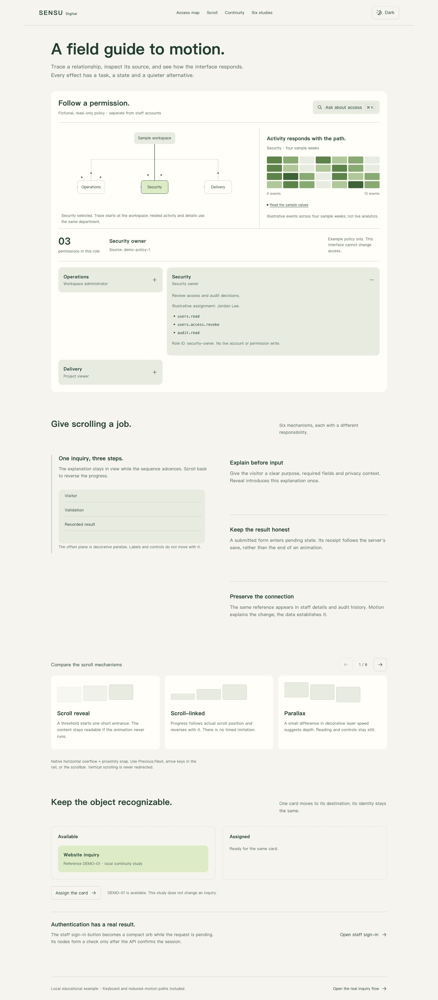
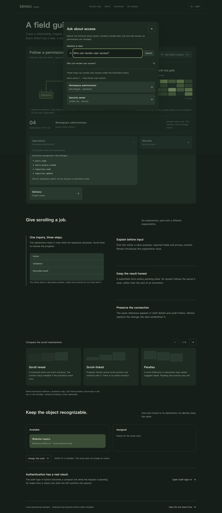

# Motion from task to implementation

Version 0.7.0 adds a running `/motion-atlas` and two portable references: [placement decisions](../skills/fullstack-web-delivery/references/motion-placement.md) and [implementation recipes](../skills/fullstack-web-delivery/references/motion-recipes.md). It reuses the confirmed business brief and existing visual identity. It adds no runtime dependency and does not replace the six earlier [interaction studies](interaction-studies.md).

## Operate the example

Start the [complete example](example-guide.md), then open `http://127.0.0.1:4319/motion-atlas`. Select Operations, Security or Delivery. One department ID connects the root-to-department trace, illustrative activity grid, permission count and inline role details. Open a detail card to see adjacent content yield in normal flow. These names, assignments and values are fictional; this interface cannot change staff access.

Press Command+K on macOS or Ctrl+K elsewhere, or use **Ask about access**. Ask **Who can revoke user access?** The server returns the two roles that actually contain `users.access.revoke` in the declared fictional policy, with its version and rule. The owner's equivalent Chinese question is also supported. This is a bounded demonstration query, not an unrestricted AI assistant or an IAM administration service. Audit, billing, ambiguous and multi-scope permission questions receive an explicit unsupported result with no role answer. Ordinary role/team searches include Operations, Security and Delivery. Select an answer to open and focus its department. Escape closes the dialog and returns focus. Loading errors can recover through a successful subsequent query; obsolete initial requests cannot overwrite its model.

Scroll through **Give scrolling a job**. The small reading sequence demonstrates distinct responsibilities: intersection-triggered entrance, actual scroll-progress mapping, decorative parallax and bounded native sticky context. The local comparison rail uses native horizontal overflow and proximity snap, with a visible scrollbar, arrow-key scrolling and Previous/Next controls. Its measured tail permits the last item to reach the same alignment. Vertical wheel behavior remains native. Narrow layouts return sticky context to normal document flow.

Use **Assign the card**, then **Return the card** to reverse one stable DEMO-01 card between two slots. The written result identifies it as a local study; no inquiry is changed. Use **Open staff sign-in** for the real authentication flow. Its stable submit control contracts during the actual pending request. Nodes form a check only after the API confirms the session, followed by a bounded 420 ms confirmation beat before administration. Reduced motion removes the additional beat. Failed credentials restore the control, retain inputs and focus the error.

The appearance button switches the atlas and its portaled command dialog between light and dark, storing only a local appearance preference. It does not change the separate business site's appearance.

## Allocate effects before building

The answered brief now generates 17 specification files, including [MOTION-MAP.md](generated/sensu/MOTION-MAP.md). The populated example has 16 placements tied to real page/action IDs. Each names its task purpose, trigger, actual driver, timing, interruption, reduced-motion behavior, fallback and verification. The [UI/UX prompt](generated/sensu/UI-UX-PROMPT.md) points implementers to that map. The generator checks page/action references and required driver fields; an invalid relationship is rejected before output writes.

| Task or element | Mechanism | State or source |
| --- | --- | --- |
| Reading sequence | Threshold reveal, scroll-linked progress, bounded parallax, sticky context | Real section scroll range; labels remain stationary |
| Local comparison rail | Horizontal native overflow and proximity snap | Actual item positions, measured tail and settled index |
| Staff sign-in | Submit-surface morph, orbiting nodes, drawn check | Actual authentication response; failure never shows success |
| Department selection | Path drawing, root-to-target trace, heatmap wave, rolling count | One selected source ID and the declared server policy |
| Role disclosure | Inline expansion and neighboring layout transforms | Expanded department ID; normal-flow content |
| Local card study | Reversible shared-element spring | One card identity and explicit local destination state |
| Command dialog | Immediate feedback, pending/result/error/unsupported recovery | Bounded GET query; source rule and role IDs |
| Appearance | Semantic light/dark token switch | Local preference, including portaled content |

These effects are selected by purpose. A public service page need not contain a permission graph; an operational workspace need not animate every entrance. The palette and layout belong to this example. A different client's field, audience, content and primary task should produce a different composition and allocation.

## Learn from a reference without copying it

The owner supplied an approximately 50-second video. Local inspection used coarse frames and denser samples around login, command search, relationships, heatmap and expansion. The implementation recreates the mechanisms with original SENSU content and the existing stack. No reference branding, artwork, people, original clip or extracted frames are distributed. Observed sequence is distinct from inferred easing; still images do not establish exact frame rate or touch feel.

The implementation uses existing React/Motion/Radix and native browser mechanisms. Official references distinguish [scroll values](https://motion.dev/docs/react-use-scroll), [layout transitions](https://motion.dev/docs/react-motion-component) and [CSS snap](https://developer.mozilla.org/en-US/docs/Web/CSS/Guides/Scroll_snap). These are mechanism sources, not approval of the example or a universal visual style.

## Inspect source and evidence

- [MotionAtlas.jsx](../examples/sensu-enterprise/src/MotionAtlas.jsx): command lifecycle/recovery, selected-state coordination, graph, heatmap, disclosures, scroll and continuity.
- [MotionPrimitives.jsx](../examples/sensu-enterprise/src/MotionPrimitives.jsx): orb/check presentation and digit tracks; [App.jsx](../examples/sensu-enterprise/src/App.jsx) owns actual login confirmation.
- [access-demo.mjs](../examples/sensu-enterprise/server/access-demo.mjs): deterministic fictional read-only policy and bounded query grammar; [API](../examples/sensu-enterprise/server/api.mjs) validates input.
- [Independent finish review](../evidence/motion-finish-review.md): original findings, fixes and scoped ship verdict. [Design documentation](../evidence/motion-design-documentation.md) records the extension's actual system.
- [Verification](verification.md): executed tests, browser observations, retained failures, capture integrity and unverified limits.

Keyboard paths, live reduced-motion changes and narrow layout were operated locally. A physical touch device, measured FPS and comprehensive accessibility/security/performance acceptance remain unverified. The client/SSR build succeeds with a roughly 566 kB minified client chunk and a size advisory; no performance certification is implied.
