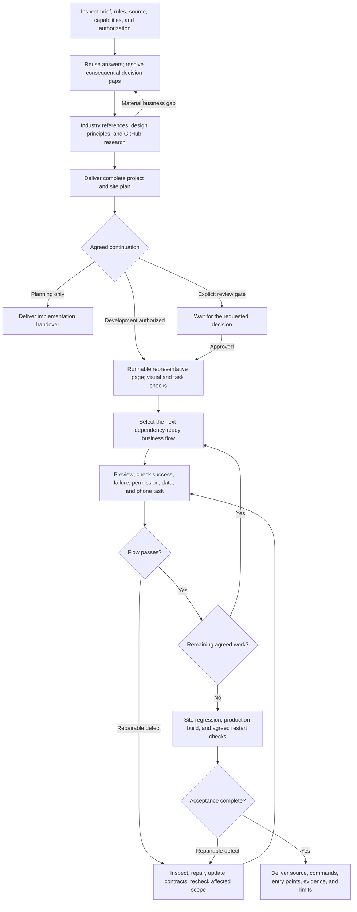
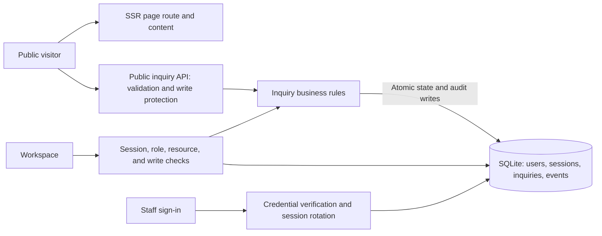

# Workflow and agent decisions

The complete plan precedes implementation. After planning, development advances by an end-to-end business task rather than separate frontend and backend batches.

# # Information routing

| Missing information | Action |
| --- | --- |
| Supplied requirement or authorization | Read and reuse it |
| A runtime, route, API, script, or available tool | Inspect actual source/environment |
| Customer positioning, content fact, commercial rule, or material preference | Ask a focused question |
| A reversible delegated implementation/design choice | Record a reasoned default and proceed |
| Required credential, access, or external capability | Mark only its dependent branch blocked; state a recovery condition |

An inaccessible mandatory branch cannot be counted as accepted. Continue unrelated work when possible. Stop blind retries after two attempts without new evidence or a plausible repair; retain reproduction and the next dependency. For a result that may already have been committed, inspect it or use the agreed idempotency mechanism before retrying.

# # Dependency order in the inquiry example

| Increment | What runs | Exit evidence |
| --- | --- | --- |
| Baseline and design | Real content, runnable page, tokens, service scenes | Reachable page; visual and task checks |
| Visitor inquiry | Validation, CSRF, idempotency, SQLite, receipt | Receipt matches a saved record |
| Employee access | Sign-in, session, search, details, read-only role | Same reference visible; direct write denied |
| Administrator handling | Version check, legal transition, transactional audit | Same record advances with matching history |
| Responsive interaction | Navigation, form focus, drawer, list, reduced motion | Operated behavior and actual viewport evidence |
| Final acceptance | Production pages, core flow, restart | Commands and data/session readback |

Record why this task is next, its prerequisites, completion rule, actual result, and next action. A status label such as active or completed is not evidence that a process ran or a workflow passed.

# # Request architecture

These layers share one server in the example. The diagram does not require microservices. Public content rendering is distinct from anonymous submission. Protected operations pass server checks before business work. A saved inquiry does not imply an email was sent.

# # Interruption and handover

Persist facts, decisions, source revision, owned process, evidence, current failure, dependency, and next action. Resume by checking current files, processes, tools, and authorization. A previous localhost address may no longer be running. Scheduling and external communication require their actual platform capabilities and the relevant authorization.
