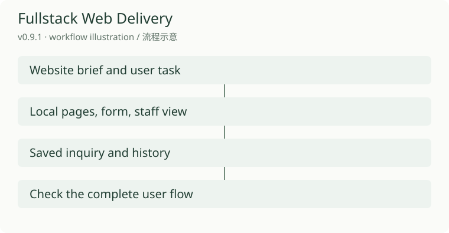

# Fullstack Web Delivery

English | [简体中文](README.zh-CN.md)

Take a website brief through design, working pages, and a checked local handoff. The included SENSU example gives the workflow something concrete to test: an inquiry form, staff access, and a saved history.

[Download v0.9.1](https://github.com/KarmenLoop/fullstack-web-delivery/releases/tag/v0.9.1) · [Guide](docs/tutorial.en.md) · [Issues](https://github.com/KarmenLoop/fullstack-web-delivery/issues)

## What it does

This is a website-delivery skill plus a fictional business example built with React, Express, and SQLite. The example runs locally; email delivery, payment, and external CRM connections are not included.

*Workflow illustration for v0.9.1; not an application screenshot or runtime acceptance.*

## Start here

Choose the complete ZIP for the example and bilingual guides. The smaller skill ZIP contains only the portable workflow. Put its fullstack-web-delivery folder in one host-supported skill directory, using a fresh destination.

For the SENSU example use Node 22.13+ within Node 22 and npm. In examples/sensu-enterprise run npm ci, npm run setup, npm run build, then npm start. Open http://127.0.0.1:4319. Setup writes random local access details to .local/demo-access.json; keep that file private.

## A first useful task

Submit a fictional inquiry, find its returned reference in the read-only staff view, and use the administrator role to advance its status. Reload and check that the history remains.

Use the website skill for one bounded page change. Check the real form and its error path before declaring it complete. Material studies and older captures keep their recorded versions; they are not fresh device or performance acceptance.

## Questions

**Is SENSU a deployed customer website?** No. It is a fictional local example. Deployment, accounts, mail, and external services need separate configuration and checks.

## Documentation and license

[Download, setup, practice, and updates](docs/tutorial.en.md) · [LICENSE](LICENSE)

KarmenLoop Source-Available No-Modification License 1.0. The original license terms govern use and redistribution; retain the included legal files. [KarmenLoop](https://karmenloop.com).
